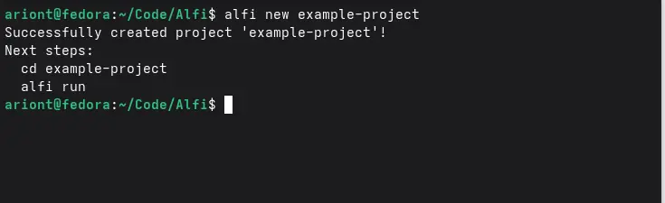
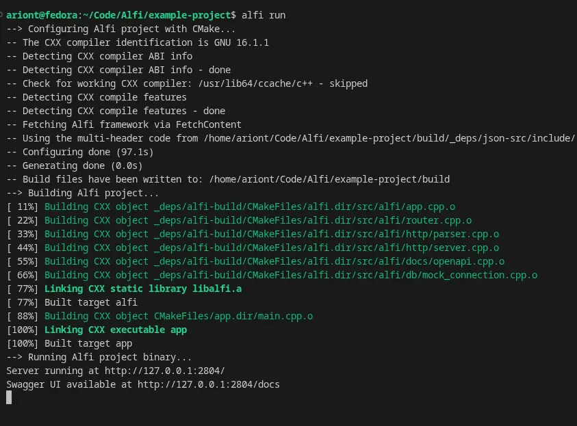

# Quick Start

This guide walks you through creating and running your first Alfi application.

By the end of this guide, you will have a running HTTP server with a health-check endpoint and automatically generated API documentation.

## Create a Project

Use the `alfi new` command to create a new Alfi project:

```bash
alfi new example-project
```

Replace `example-project` with the name you want to use for your application.

Alfi creates the project directory and generates the initial files required to build the application.

You should see output similar to:

```text
Successfully created project 'example-project'!

Next steps:
  cd example-project
  alfi run
```



## Enter the Project

Move into the newly created project:

```bash
cd example-project
```

The project is now ready to build and run.

## Run the Application

Start the application using the Alfi CLI:

```bash
alfi run
```

The `alfi run` command configures the project with CMake, builds the application, and starts the resulting executable.

You should see output similar to:

```text
--> Configuring Alfi project with CMake...
--> Building Alfi project...
...
[100%] Built target app
--> Running Alfi project binary...

Server running at http://127.0.0.1:2804/
Swagger UI available at http://127.0.0.1:2804/docs
```



Your Alfi application is now running.

## Test the Application

Open another terminal while the server is running.

The generated application includes a `/health` endpoint that can be used to verify that the server is responding.

Run:

```bash
curl http://127.0.0.1:2804/health
```

The server should return:

```json
{
  "status": "ok"
}
```

You can also open the endpoint directly in your browser:

```text
http://127.0.0.1:2804/health
```

## API Documentation

Alfi automatically provides API documentation for the application.

Open:

```text
http://127.0.0.1:2804/docs
```

This opens the Swagger UI for your application.

Alfi also exposes the generated OpenAPI specification at:

```text
http://127.0.0.1:2804/openapi.json
```

You can use Swagger UI to explore and test the routes registered by your application.

## What Just Happened?

The `alfi new` command created the initial Alfi project for you.

The `alfi run` command then:

1. Configured the project with CMake.
2. Built the application.
3. Started the generated executable.
4. Started the HTTP server.

The generated application already contains a basic `/health` route, allowing you to verify that everything is working before adding your own routes.

## What's Next?

Now that you have a running Alfi application, the next step is to understand what was created for you.

Continue with **[New Project](./new-project.md)** to learn about the generated project structure and the purpose of each file.
